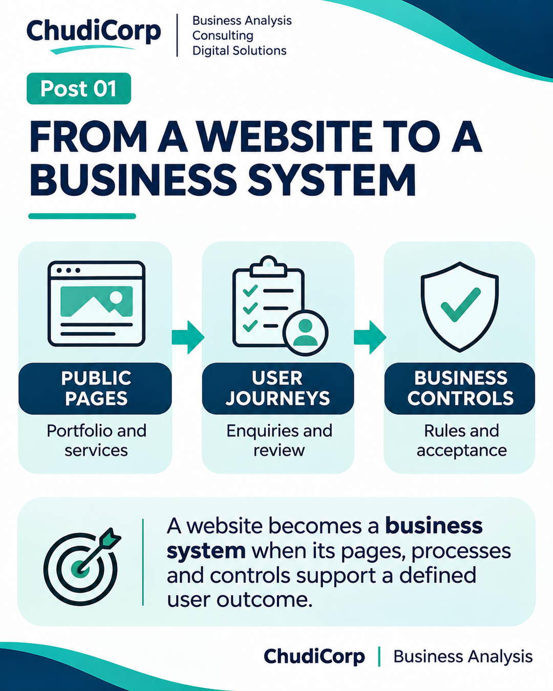
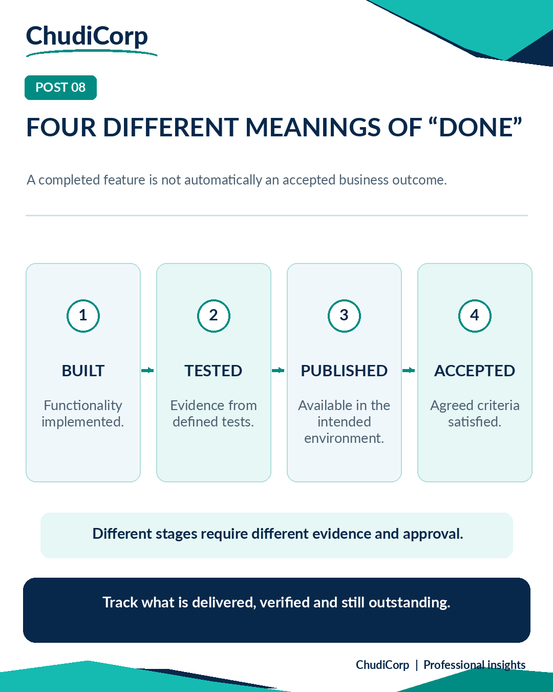
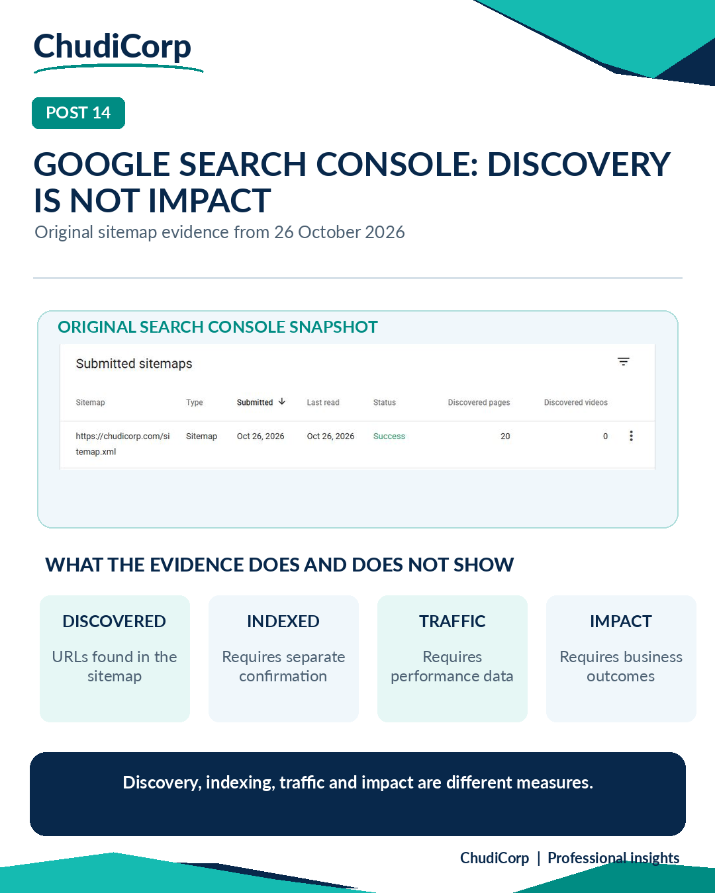

# ChudiCorp: From Digital Product Development to Evidence-Led Thought Leadership
*An Integrated Business Analysis, Product Delivery, Data Analytics and AI Governance Portfolio Project*

I turned real experience from developing my business website, ChudiCorp.com,
into a 15-part educational LinkedIn programme with 15 supporting graphics, and
then reviewed every claim against the project's records. This repository shows
how: the method, the evidence behind each post and the limits of that evidence.

## Two connected projects
**Project A — the ChudiCorp website (source of experience).** A business-insight
website implemented through Lovable. Created May 2026, with intensive
implementation and assurance work in October 2026: protected administration,
private pricing with tailored quotes, Stripe Test Mode checkout and
reconciliation monitoring, spam protection, search foundations and
business-email admin access. 24 recorded milestones (M01–M24). The latest
production acceptance decision was conditional.

**Project B — the knowledge-sharing programme (this portfolio).** 15 LinkedIn
posts and graphics that I prepared, approved and manually scheduled. Formal
evidence (Stage A) and visual (Stage B) reviews were carried out afterwards to
strengthen this portfolio.

## What I did
- Set the objectives and selected the 15 professional topics
- Directed priorities and the website's V1 scope decisions
- Reviewed material and made editorial and disclosure decisions
- Carried out owner checks recorded in the project (for example, admin pricing
  view, test-card outcomes, business email, Search Console)
- Approved all content and graphics, and scheduled every post

ChatGPT assisted with research, analysis, drafting, visual preparation and
critical review (owner-confirmed). Lovable implemented the website and recorded
the technical evidence.

## Case studies by workstream
| Workstream | Case studies |
|---|---|
| Business Analysis and Process Improvement | [01 Website to business system](posts/post-01.md) · [02 Requirement vs acceptance criterion](posts/post-02.md) · [06 After Submit](posts/post-06.md) · [07 Scope before price](posts/post-07.md) |
| Product and Project Delivery | [03 What belongs in V1](posts/post-03.md) · [08 Four meanings of done](posts/post-08.md) · [09 Did the automation run?](posts/post-09.md) |
| Data Analytics and Evidence | [04 Dashboard is not the case study](posts/post-04.md) · [05 Patient-flow scenario](posts/post-05.md) · [14 Discovery is not impact](posts/post-14.md) |
| AI Governance and Information Protection | [10 Human oversight in AI](posts/post-10.md) · [11 Hiding is not securing](posts/post-11.md) · [15 Human accountability](posts/post-15.md) |
| Systems Integration and Commercial Assurance | [12 End-to-end email testing](posts/post-12.md) · [13 Validation is not success](posts/post-13.md) |

## Selected visuals

  
  
  

## How evidence is handled
Every claim is labelled by source (Documented, Lovable-reported,
Owner-verified, Owner-confirmed, Inferred, Illustrative, Unverified) and timing
(report-recorded, inspected during review, performed at the time). A report
that a test was performed is not presented as an independent audit.
See [Methodology](METHODOLOGY.md) and [Disclosure](DISCLOSURE_AND_ATTRIBUTION.md).

## Status
- 15 posts and graphics: approved and manually scheduled
- Portfolio documentation: assembled for private review; publication not authorised
- LinkedIn performance: actual publication and performance evidence will be
  incorporated when supplied and verified
- ChudiCorp production acceptance: conditional

[Charter](PROJECT_CHARTER.md) · [Case study](CASE_STUDY.md) ·
[Content index](CONTENT_INDEX.md) · [Quality gate](frameworks/QUALITY_GATE.md) ·
[Metrics](performance/METRICS.md)

© Chudi Nwachukwu. All rights reserved. No open-source licence is granted.
