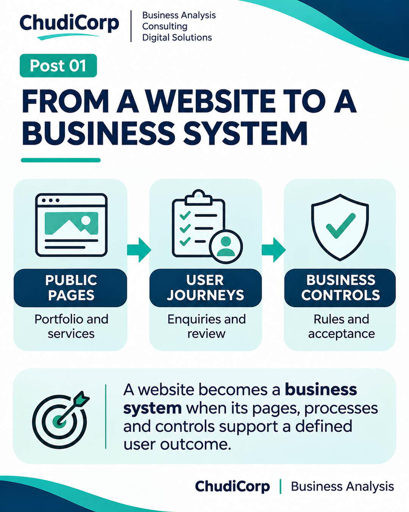

# Post 01: From a Website to a Business System

**Workstream:** Business Analysis and Process Improvement  
**Scheduling status:** LinkedIn, scheduled for 2 November 2026 at 09:00 GMT by the project owner  
**Original LinkedIn URL:** Not added until independently confirmed  
**Evidence source:** Documented and Lovable-reported  
**Evidence verification / timing:** Report-recorded

## Original approved LinkedIn caption

I started developing ChudiCorp as a website project.

But the more I worked through the requirements, the clearer something became.

I wasn't just building a website. I was defining a business system.

It needed a portfolio, service descriptions, enquiry forms, an administration area and a way to manage customer requests.

Then came the questions that weren't immediately visible on a homepage.

What should happen after someone submits an idea?

Who reviews it?

What information should be protected?

What happens when something goes wrong?

These are familiar Business Analysis questions.

And they reinforced something I believe: digital projects should begin with a clear understanding of the business problem, not a list of attractive features.

One exercise I find useful is to describe a feature in three ways:

1. What the user wants to accomplish.
2. What the business needs to happen.
3. What could prevent a successful outcome.

That simple exercise can expose gaps before development begins.

What is the first question you ask when someone brings you a new digital project?

#BusinessAnalysis #DigitalTransformation #RequirementsEngineering

## Evidence-based professional case study

### Professional problem

When does a website project become a business-systems problem?

### ChudiCorp context

ChudiCorp began as a portfolio site. Its requirements soon included enquiry handling, review, protected administration and request tracking.

### Professional technique

Capability decomposition: pages lead to user journeys, journeys need business rules, and rules need controls.

### Implementation or delivery context

Public pages, eight portfolio categories, an idea form with saved references, and an admin area with 11 statuses, notes, scoring and suggested service.

### Testing and documentation

Lovable-reported checks of saving submissions and reading them back in admin; authentication verified (Report-recorded). Not every status transition was individually exercised.

### Owner confirmation

Admin access confirmed by the owner.

### Supporting milestones

M01–M04.

### Illustrative or retrospective elements

The "pages → journeys → controls" framing is a retrospective teaching model (Inferred).

### Limitations and disclosures

None beyond the general disclosures.

### Transferable professional lesson

BA: elicit the processes behind each screen. PM/Product: scope covers operations, not just pages.

## Evidence boundaries

The supporting internal development records remain private. Milestone references are traceability identifiers, not links to private reports. Lovable-reported tests are not represented as independent audits. Scheduled publication dates do not establish that a LinkedIn post was published.

[Back to content index](../CONTENT_INDEX.md) | [Portfolio overview](../README.md) | [Disclosures](../DISCLOSURE_AND_ATTRIBUTION.md)
