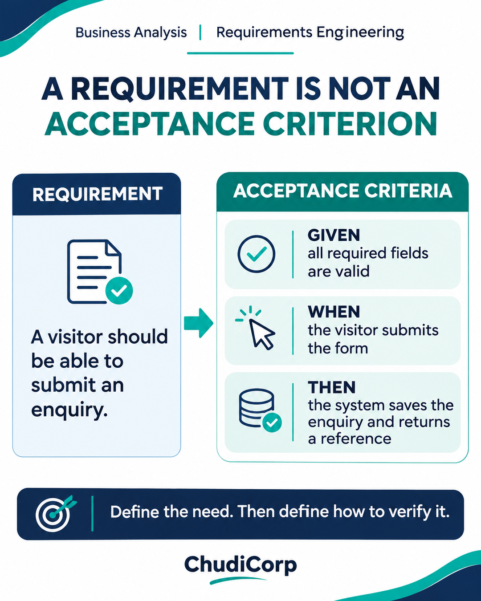

# Post 02: A Requirement Is Not an Acceptance Criterion

**Workstream:** Business Analysis and Process Improvement  
**Scheduling status:** LinkedIn, scheduled for 4 November 2026 at 09:00 GMT by the project owner  
**Original LinkedIn URL:** Not added until independently confirmed  
**Evidence source:** Lovable-reported  
**Evidence verification / timing:** Performed historically in preview, report-recorded

## Original approved LinkedIn caption

“The user should be able to submit a form.”

That sounds like a requirement.

But how would we know it actually works?

While developing ChudiCorp, I found that describing what a feature should do was only the beginning.

Take an online business enquiry form.

It should collect the right information, validate required fields and provide an acknowledgement.

But what happens when a required field is missing?

What happens when a submission fails?

How does an administrator know which request needs attention?

This is where acceptance criteria become valuable.

For example:

Given a visitor has completed all required fields,

When they submit a valid enquiry,

Then the system should process it and return a reference they can use for follow-up.

We can also define separate scenarios for invalid data, duplicate submissions and system errors.

A well-written requirement explains the need.

A good acceptance criterion helps us decide whether the need has been met.

How often do you encounter requirements that sound complete until testing begins?

#BusinessAnalysis #RequirementsEngineering #SoftwareTesting

## Evidence-based professional case study

### Professional problem

How do you know a requirement has been met?

### ChudiCorp context

The enquiry form needed to save requests, return a reference and resist spam.

### Professional technique

Given/When/Then acceptance criteria.

### Implementation or delivery context

Saved enquiries with unique references and shared validation (M03). Spam validation (M16). Spam and abuse-prevention controls (M21).

### Testing and documentation

Lovable-reported tests of the preview submission and the automated spam tests. The live human-check box was observed during review.

### Owner confirmation

None recorded for live submission.

### Supporting milestones

M03, M16, M21.

### Illustrative or retrospective elements

The specific Given/When/Then wording in the graphic is a teaching example.

### Limitations and disclosures

A live submission and real rate-limit acceptance are still outstanding.

### Transferable professional lesson

BA/QA: write criteria a tester can fail. PM: "built" is not "accepted".

## Evidence boundaries

The supporting internal development records remain private. Milestone references are traceability identifiers, not links to private reports. Lovable-reported tests are not represented as independent audits. Scheduled publication dates do not establish that a LinkedIn post was published.

[Back to content index](../CONTENT_INDEX.md) | [Portfolio overview](../README.md) | [Disclosures](../DISCLOSURE_AND_ATTRIBUTION.md)
