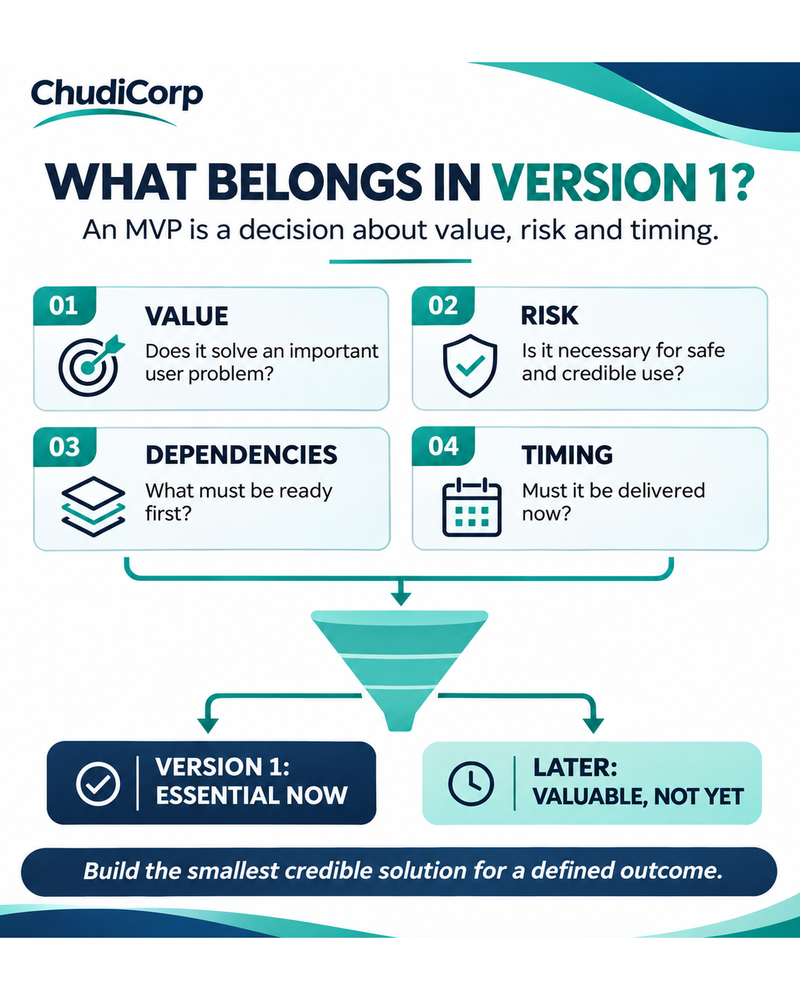

# Post 03: What Belongs in Version 1?

**Workstream:** Product and Project Delivery  
**Scheduling status:** LinkedIn, scheduled for 6 November 2026 at 09:00 GMT by the project owner  
**Original LinkedIn URL:** Not added until independently confirmed  
**Evidence source:** Documented and inferred  
**Evidence verification / timing:** Report-recorded; retrospective teaching model

## Original approved LinkedIn caption

One of the hardest decisions in building a digital product is deciding what NOT to build.

It's easy to keep adding ideas.

A dashboard here. Another automation there. More features because they might become useful later.

During ChudiCorp's development, I had to think about what belonged in the first version and what could reasonably wait.

That is a product decision, not simply a technical decision.

A useful way to prioritise features is to ask:

Does this help the main user complete an important task?

Is it necessary for a safe and usable first release?

What happens if we leave it out for now?

How much additional complexity will it create?

A feature can be valuable and still be the wrong priority today.

To me, a good minimum viable product is not the smallest collection of features possible.

It is the smallest credible solution that supports a meaningful outcome, with the controls appropriate to its risks.

When prioritising a product backlog, how do you distinguish “essential now” from “valuable later”?

#ProductManagement #ProductOwner #MVP

## Evidence-based professional case study

### Professional problem

How do you decide what goes into a first release?

### ChudiCorp context

V1 was limited to one-time consulting, manual review and delivery, and no customer accounts or subscriptions.

### Professional technique

A value, risk, dependency and timing filter.

### Implementation or delivery context

One-time sandbox checkout and manual delivery workflow (M06), within the V1 scope (M01).

### Testing and documentation

The scope decisions are documented in the project records (Report-recorded).

### Owner confirmation

The owner chose one-time purchases and no subscriptions (Documented decision).

### Supporting milestones

M01, M06.

### Illustrative or retrospective elements

The four-factor filter is applied retrospectively. No formal scoring matrix existed during development (Inferred).

### Limitations and disclosures

Present the filter as a lens for explaining the decision, not as the method used at the time.

### Transferable professional lesson

Product: protect V1 from scope creep. PM: record what was deferred and why.

## Evidence boundaries

The supporting internal development records remain private. Milestone references are traceability identifiers, not links to private reports. Lovable-reported tests are not represented as independent audits. Scheduled publication dates do not establish that a LinkedIn post was published.

[Back to content index](../CONTENT_INDEX.md) | [Portfolio overview](../README.md) | [Disclosures](../DISCLOSURE_AND_ATTRIBUTION.md)
