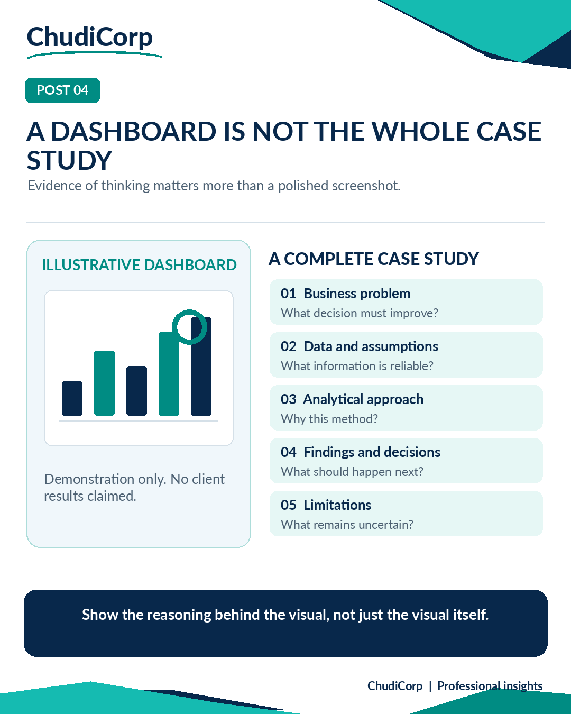

# Post 04: A Dashboard Is Not the Whole Case Study

**Workstream:** Data Analytics and Evidence  
**Scheduling status:** LinkedIn, scheduled for 8 November 2026 at 09:00 GMT by the project owner  
**Original LinkedIn URL:** Not added until independently confirmed  
**Evidence source:** Illustrative  
**Evidence verification / timing:** Inspected during Stage B review

## Original approved LinkedIn caption

A dashboard screenshot might attract attention.

But does it tell someone how you think?

This is a question I've been considering while developing the ChudiCorp portfolio.

A polished dashboard can show that you know how to present information. It doesn't necessarily show how you identified the business problem, selected the right measures or validated your conclusions.

I think a stronger analytics portfolio should answer five questions:

What was the business question?

What data would be needed?

How would the analysis be carried out?

What decisions would the findings support?

What limitations should the reader understand?

ChudiCorp currently includes illustrative project scenarios, not completed client engagements.

That distinction matters.

A hypothetical project can still be useful evidence of analytical thinking, provided its assumptions and results are clearly identified as illustrative.

For me, credibility starts with showing the reasoning, not just the finished visual.

When reviewing someone's analytics portfolio, what matters more to you: the dashboard or the explanation behind it?

#DataAnalytics #PowerBI #PortfolioDevelopment

## Evidence-based professional case study

### Professional problem

What makes analytics work credible?

### ChudiCorp context

The ChudiCorp portfolio shows demonstration projects with illustrative figures.

### Professional technique

Tell the story as problem, then reasoning, then visual, then decision.

### Implementation or delivery context

Real category counts, retained demonstration labels, and link previews that show demonstration status (M10).

### Testing and documentation

Counts and labels verified (Report-recorded).

### Owner confirmation

None.

### Supporting milestones

M10.

### Illustrative or retrospective elements

The dashboard in the graphic is illustrative.

### Limitations and disclosures

Demonstration only. No client results are claimed.

### Transferable professional lesson

Data analytics: show the reasoning behind a visual. Hiring: label demonstrations honestly.

## Evidence boundaries

The supporting internal development records remain private. Milestone references are traceability identifiers, not links to private reports. Lovable-reported tests are not represented as independent audits. Scheduled publication dates do not establish that a LinkedIn post was published.

[Back to content index](../CONTENT_INDEX.md) | [Portfolio overview](../README.md) | [Disclosures](../DISCLOSURE_AND_ATTRIBUTION.md)
