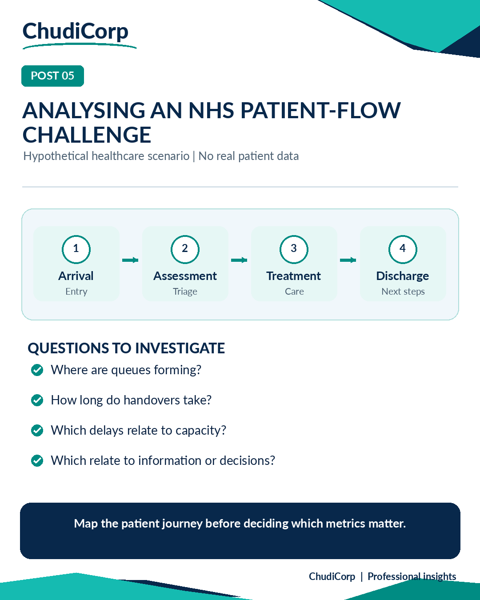

# Post 05: Analysing an NHS Patient-Flow Challenge

**Workstream:** Data Analytics and Evidence  
**Scheduling status:** LinkedIn, scheduled for 10 November 2026 at 09:00 GMT by the project owner  
**Original LinkedIn URL:** Not added until independently confirmed  
**Evidence source:** Illustrative  
**Evidence verification / timing:** Not applicable

## Original approved LinkedIn caption

Imagine an NHS service struggling with delays in patient flow.

A dashboard might show rising waiting times.

But would that tell us what to change?

Not necessarily.

If I were approaching this as a Business Analyst, I'd want to understand the journey first.

Where do patients enter the process?

What happens before a decision is made?

Where do handovers occur?

Are delays caused by capacity, information gaps, approvals or something else?

Then I'd explore the measures.

For example, median waiting time, length of stay, handover delays, delayed discharges and variation between service areas.

I'd also want to know how each measure is defined and whether the available data is sufficiently reliable.

This is a hypothetical healthcare improvement scenario, not a claim about work carried out for an NHS organisation.

The principle applies well beyond healthcare.

A metric can tell you where to investigate. Understanding the process helps you decide what to improve.

What would you investigate first in a service with persistent delays?

#HealthcareAnalytics #BusinessAnalysis #NHS

## Evidence-based professional case study

### Professional problem

Where should analysis of a service-flow problem start?

### ChudiCorp context

None from ChudiCorp. This is a conceptual scenario.

### Professional technique

Journey mapping before choosing metrics; bottleneck framing.

### Implementation or delivery context

Nothing; it is conceptual.

### Testing and documentation

Nothing.

### Owner confirmation

Not applicable.

### Supporting milestones

None.

### Illustrative or retrospective elements

The whole post is a hypothetical scenario.

### Limitations and disclosures

No real patient data and no NHS affiliation or engagement.

### Transferable professional lesson

BA/Data: understand the flow before measuring it. Public-sector awareness.

## Evidence boundaries

The supporting internal development records remain private. Milestone references are traceability identifiers, not links to private reports. Lovable-reported tests are not represented as independent audits. Scheduled publication dates do not establish that a LinkedIn post was published.

[Back to content index](../CONTENT_INDEX.md) | [Portfolio overview](../README.md) | [Disclosures](../DISCLOSURE_AND_ATTRIBUTION.md)
