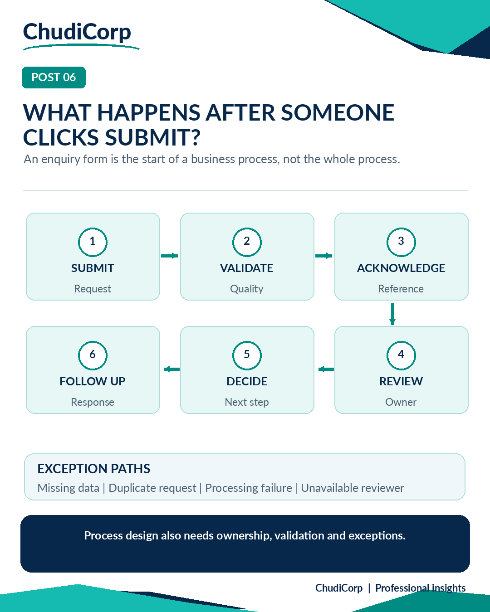

# Post 06: What Happens After Someone Clicks Submit?

**Workstream:** Business Analysis and Process Improvement  
**Scheduling status:** LinkedIn, scheduled for 12 November 2026 at 09:00 GMT by the project owner  
**Original LinkedIn URL:** Not added until independently confirmed  
**Evidence source:** Documented and illustrative  
**Evidence verification / timing:** Historical preview test, report-recorded; illustration inspected

## Original approved LinkedIn caption

Here's a small question that can reveal a surprisingly large process gap:

What happens after someone clicks Submit?

In ChudiCorp, visitors can describe a business problem and send an enquiry.

But the form is only one part of the process.

Behind it, there needs to be a clear route for receiving the request, reviewing the information, deciding what happens next and keeping an appropriate record.

That's where process mapping becomes useful.

I would break the journey into:

Submission → Validation → Acknowledgement → Review → Decision → Follow-up.

Then I'd examine the exceptions.

What if information is incomplete?

What if the request is duplicated?

What if the system cannot process it?

What if the person responsible for the next action is unavailable?

This is why I find AS-IS and TO-BE process mapping so valuable.

It forces us to think beyond individual screens and consider the entire service experience.

What is the most overlooked step in an online customer enquiry process?

#ProcessMapping #BusinessAnalysis #WorkflowAutomation

## Evidence-based professional case study

### Professional problem

What process sits behind a simple form?

### ChudiCorp context

A ChudiCorp submission creates a saved request with a reference, and the owner then manages it in admin.

### Professional technique

Process mapping with exception paths.

### Implementation or delivery context

Reference shown on screen (M03), admin statuses and notes (M04), spam guard (M21).

### Testing and documentation

Lovable-reported preview tests; process inspected during review.

### Owner confirmation

None recorded for a live submission.

### Supporting milestones

M03, M04, M21.

### Illustrative or retrospective elements

The six-step diagram is a target process. Acknowledgement email and cover for an unavailable reviewer are not V1 functions.

### Limitations and disclosures

Separate the target-process steps from V1 functions. Live acceptance is outstanding.

### Transferable professional lesson

BA: design for exceptions. Process improvement: separate the current state from the target state.

## Evidence boundaries

The supporting internal development records remain private. Milestone references are traceability identifiers, not links to private reports. Lovable-reported tests are not represented as independent audits. Scheduled publication dates do not establish that a LinkedIn post was published.

[Back to content index](../CONTENT_INDEX.md) | [Portfolio overview](../README.md) | [Disclosures](../DISCLOSURE_AND_ATTRIBUTION.md)
