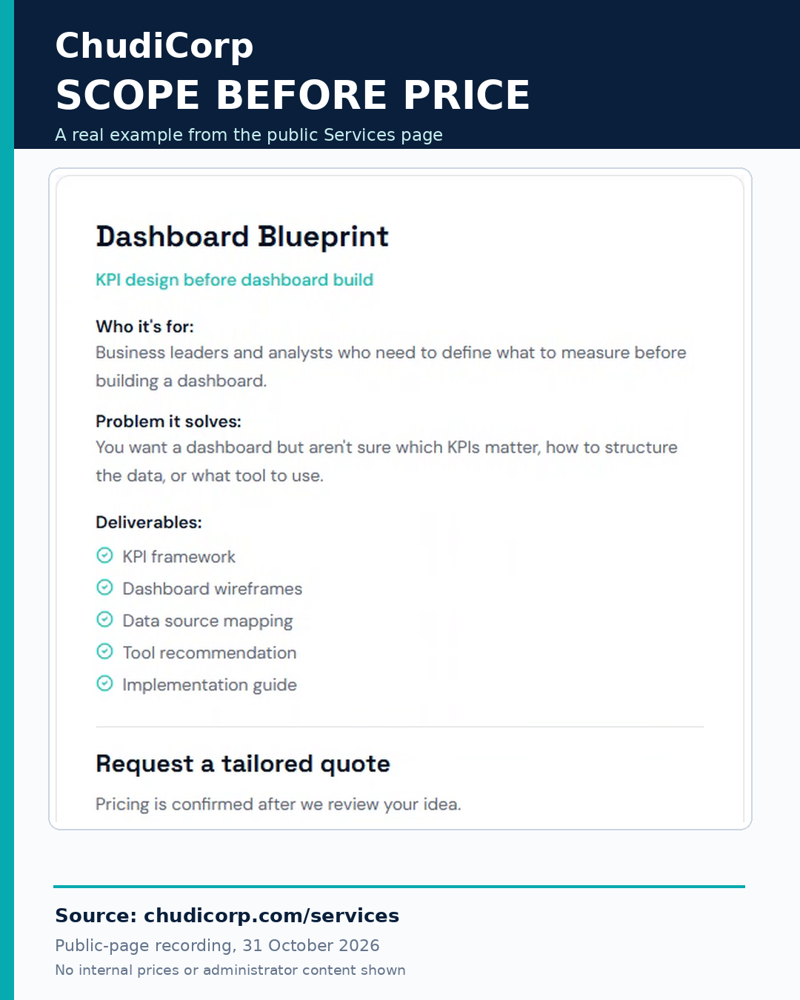

# Post 07: Scope Before Price

**Workstream:** Business Analysis and Process Improvement  
**Scheduling status:** LinkedIn, scheduled for 14 November 2026 at 09:00 GMT by the project owner  
**Original LinkedIn URL:** Not added until independently confirmed  
**Evidence source:** Documented and owner-verified  
**Evidence verification / timing:** Report-recorded; public wording inspected during review

## Original approved LinkedIn caption

A fixed price is useful when the work is clearly defined.

But what happens when the problem itself hasn't been fully understood?

This came up while refining ChudiCorp's service offerings.

I decided to remove the displayed service-price ranges from the public website and use a tailored-quotation approach instead.

The reason wasn't simply about pricing.

It was about scope.

Someone asking for help with a dashboard might need a review of existing KPIs.

Another organisation might need data cleaning, requirements gathering, process mapping and a completely new reporting approach.

Those are different pieces of work.

Before preparing a quotation, I'd want to understand:

The problem being addressed.

The intended outcome.

The available information.

The expected deliverables.

The assumptions, dependencies and constraints.

That doesn't mean pricing should be mysterious.

It means a quotation should reflect a defined scope, rather than an assumption about what the client needs.

In consulting, should scope come before price, or can a published price help establish the scope?

#BusinessAnalysis #Consulting #ScopeManagement

## Evidence-based professional case study

### Professional problem

Why agree scope before quoting a price?

### ChudiCorp context

ChudiCorp removed public prices and offers tailored quotes.

### Professional technique

Value-based scoping and quote governance.

### Implementation or delivery context

Owner-editable private pricing kept separate from customer quotes (M05). Clear tailored-quote wording on mobile (M22). Price-free public pages and data, with restricted access to price data (M23).

### Testing and documentation

Lovable-reported checks across screen sizes and of the live release; the Services wording was inspected during review.

### Owner confirmation

The owner viewed the admin pricing page on 31 October 2026 (Owner-verified).

### Supporting milestones

M05, M22, M23.

### Illustrative or retrospective elements

The graphic is a designed reproduction.

### Limitations and disclosures

This educational graphic reproduces the publicly visible Dashboard Blueprint service information from ChudiCorp's Services page. Its wording was verified against the website. It is a designed presentation rather than an independently authenticated browser screenshot from 31 October 2026.

### Transferable professional lesson

Consulting/Product: protect pricing flexibility. BA: commercial rules are requirements too.

## Evidence boundaries

The supporting internal development records remain private. Milestone references are traceability identifiers, not links to private reports. Lovable-reported tests are not represented as independent audits. Scheduled publication dates do not establish that a LinkedIn post was published.

[Back to content index](../CONTENT_INDEX.md) | [Portfolio overview](../README.md) | [Disclosures](../DISCLOSURE_AND_ATTRIBUTION.md)
