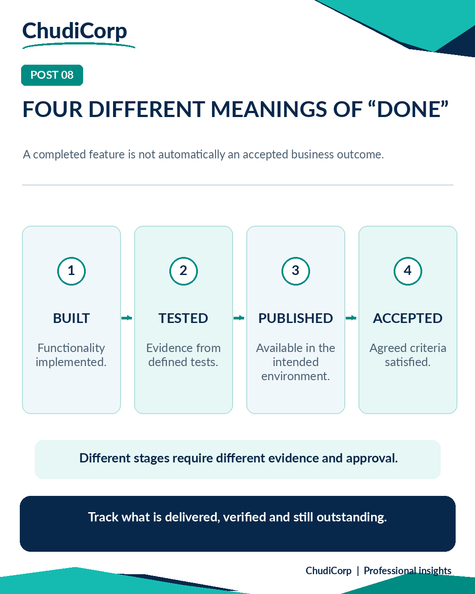

# Post 08: Four Different Meanings of "Done"

**Workstream:** Product and Project Delivery  
**Scheduling status:** LinkedIn, scheduled for 16 November 2026 at 09:00 GMT by the project owner  
**Original LinkedIn URL:** Not added until independently confirmed  
**Evidence source:** Documented  
**Evidence verification / timing:** Report-recorded

## Original approved LinkedIn caption

A feature can be finished and still not be ready.

I've been thinking about this distinction while reviewing the milestones for ChudiCorp.

There are at least four different meanings of “done” in a digital project.

Built: the required functionality has been implemented.

Tested: there is evidence that it behaves as expected under the conditions tested.

Published: the functionality is available in the intended environment.

Accepted: the agreed acceptance criteria have been satisfied.

These are not interchangeable.

A successful automated test does not prove every real-world scenario works.

A feature appearing on a live website does not mean all its operational checks have passed.

And a completed development milestone is not necessarily the same as business approval.

This is why I think project reporting needs to distinguish progress from assurance.

It's also why I prefer to document what remains unverified rather than simply mark everything green.

In your projects, who decides when “done” really means done?

#ProjectManagement #PMO #QualityAssurance

## Evidence-based professional case study

### Professional problem

What does "done" actually mean?

### ChudiCorp context

ChudiCorp has 24 milestones, but its production acceptance is conditional.

### Professional technique

A delivery-state model: Built, Tested, Published, Accepted.

### Implementation or delivery context

QA reports and handover (M15), the owner's launch checklist (M18), and a coordinated release with rollback readiness (M23).

### Testing and documentation

The production acceptance report records Passed, Requires Owner Verification and Outstanding categories (Report-recorded).

### Owner confirmation

Checklist sign-offs (Owner-verified in the app).

### Supporting milestones

M15, M18, M23, plus the conditional production acceptance report.

### Illustrative or retrospective elements

None.

### Limitations and disclosures

Do not imply full acceptance. Checklist ticks are not QA certification.

### Transferable professional lesson

PM: report status precisely. Stakeholders: acceptance is a business decision.

## Evidence boundaries

The supporting internal development records remain private. Milestone references are traceability identifiers, not links to private reports. Lovable-reported tests are not represented as independent audits. Scheduled publication dates do not establish that a LinkedIn post was published.

[Back to content index](../CONTENT_INDEX.md) | [Portfolio overview](../README.md) | [Disclosures](../DISCLOSURE_AND_ATTRIBUTION.md)
