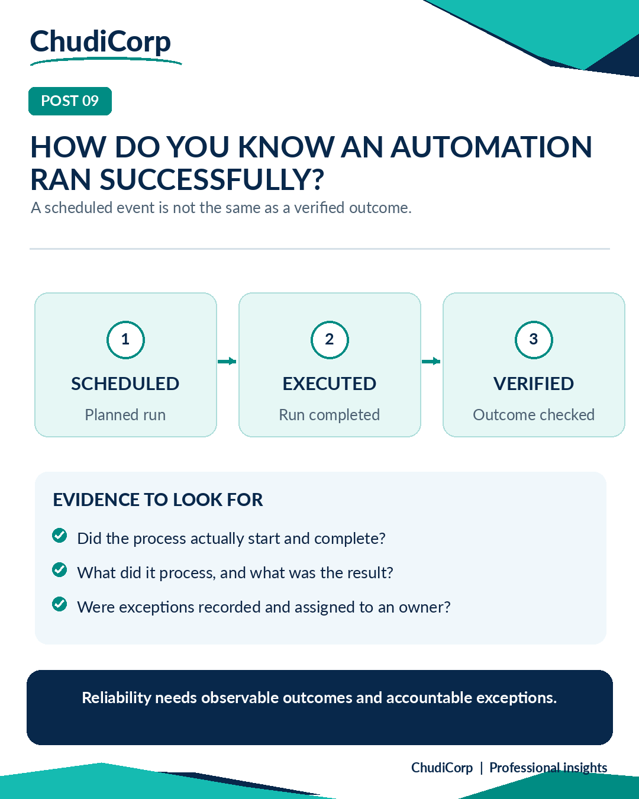

# Post 09: How Do You Know an Automation Ran Successfully?

**Workstream:** Product and Project Delivery  
**Scheduling status:** LinkedIn, scheduled for 18 November 2026 at 09:00 GMT by the project owner  
**Original LinkedIn URL:** Not added until independently confirmed  
**Evidence source:** Lovable-reported  
**Evidence verification / timing:** Historically performed and report-recorded

## Original approved LinkedIn caption

An automation running on schedule is not quite the same as an automation doing its job successfully.

That distinction matters more than it first appears.

While developing ChudiCorp, we introduced scheduled monitoring for payment reconciliation in the testing environment.

It raised a useful question:

How do we know whether a scheduled process actually did what we expected?

I would look for more than a timestamp.

Did it start?

Did it complete?

How many records did it examine?

Were any exceptions detected?

Was the outcome recorded?

And if something failed, who would know?

This thinking applies to far more than payments.

A PMO reporting process, an overnight data refresh or a workflow automation can all appear to run while still producing incomplete information.

For me, reliable automation needs three things: clear expected outcomes, observable execution and someone accountable for exceptions.

What's the first thing you check when an automated process reports that it ran successfully?

#WorkflowAutomation #PMO #OperationalExcellence

## Evidence-based professional case study

### Professional problem

Does a scheduled job prove the work actually happened?

### ChudiCorp context

An hourly payment reconciliation was scheduled against the intended published-site address before the website was live, so early runs could not succeed. Separately, failures lacked adequate visibility until run results were recorded.

### Professional technique

A verification chain: scheduled, then executed, then verified.

### Implementation or delivery context

Hourly reconciliation with recorded run results and admin visibility (M14).

### Testing and documentation

A real scheduled run on 22 October returned success, and later runs were recorded successfully (Lovable-reported; Performed at the time).

### Owner confirmation

None.

### Supporting milestones

M14.

### Illustrative or retrospective elements

The graphic is a generic model.

### Limitations and disclosures

Failure-alert email has not been built or verified.

### Transferable professional lesson

Operations/PM: monitor outcomes, not just schedules. Data: logs are evidence.

## Evidence boundaries

The supporting internal development records remain private. Milestone references are traceability identifiers, not links to private reports. Lovable-reported tests are not represented as independent audits. Scheduled publication dates do not establish that a LinkedIn post was published.

[Back to content index](../CONTENT_INDEX.md) | [Portfolio overview](../README.md) | [Disclosures](../DISCLOSURE_AND_ATTRIBUTION.md)
