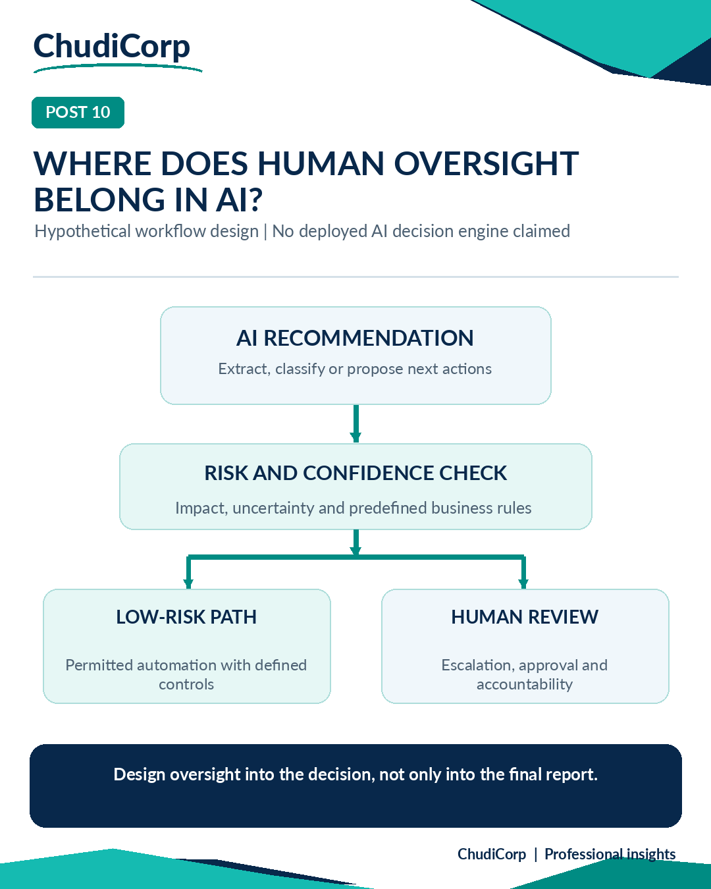

# Post 10: Where Does Human Oversight Belong in AI?

**Workstream:** AI Governance and Information Protection  
**Scheduling status:** LinkedIn, scheduled for 20 November 2026 at 09:00 GMT by the project owner  
**Original LinkedIn URL:** Not added until independently confirmed  
**Evidence source:** Illustrative  
**Evidence verification / timing:** Not applicable

## Original approved LinkedIn caption

Where should human judgement sit in an AI-powered workflow?

I don't think the answer should always be “at the end”.

Consider a hypothetical process where AI reviews business documents and prepares recommendations.

The AI could help extract information, classify requests and identify possible next steps.

But what if the document is incomplete?

What if the recommendation affects someone's finances or access to a service?

What if the model is uncertain?

Those situations need explicit controls.

Before automating a workflow, I'd want to define:

What the AI is allowed to do.

What evidence supports its output.

Which decisions require human approval.

When a case should be escalated.

How the outcome can be reviewed afterward.

I've been applying similar thinking to ChudiCorp's administration and workflow design, particularly around access, review and exception handling.

My view is that responsible automation isn't about removing people from every step.

It's about deciding which steps benefit from automation and where human judgement adds essential value.

Where would you draw the line between automated recommendations and human decisions?

#AIGovernance #ResponsibleAI #WorkflowAutomation

## Evidence-based professional case study

### Professional problem

At what point should a human review an AI recommendation?

### ChudiCorp context

None from ChudiCorp. This is a conceptual workflow.

### Professional technique

Risk-based placement of human review.

### Implementation or delivery context

Nothing.

### Testing and documentation

Nothing.

### Owner confirmation

Not applicable.

### Supporting milestones

None.

### Illustrative or retrospective elements

The whole post is a hypothetical workflow.

### Limitations and disclosures

No deployed AI decision engine is claimed.

### Transferable professional lesson

AI governance: put oversight where the risk is. Product: design escalation paths.

## Evidence boundaries

The supporting internal development records remain private. Milestone references are traceability identifiers, not links to private reports. Lovable-reported tests are not represented as independent audits. Scheduled publication dates do not establish that a LinkedIn post was published.

[Back to content index](../CONTENT_INDEX.md) | [Portfolio overview](../README.md) | [Disclosures](../DISCLOSURE_AND_ATTRIBUTION.md)
