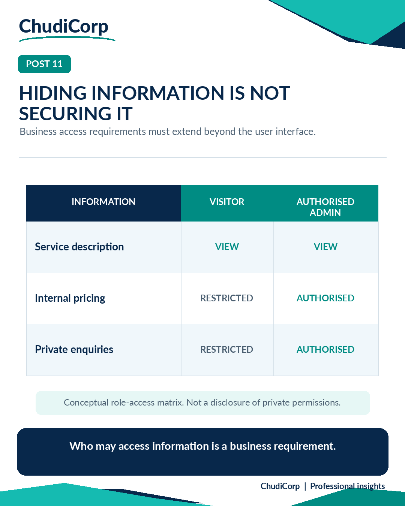

# Post 11: Hiding Information Is Not Securing It

**Workstream:** AI Governance and Information Protection  
**Scheduling status:** LinkedIn, scheduled for 22 November 2026 at 09:00 GMT by the project owner  
**Original LinkedIn URL:** Not added until independently confirmed  
**Evidence source:** Documented and Lovable-reported  
**Evidence verification / timing:** Historically performed for signed-out access; rules inspected later

## Original approved LinkedIn caption

Removing information from a screen doesn't necessarily mean the information is private.

This was an important lesson from one of ChudiCorp's later development milestones.

We wanted service packages to remain visible while keeping internal pricing out of the public website.

Changing the text on the page was straightforward.

But it raised a broader question:

What information is the system actually making available, and to whom?

As a Business Analyst, I think this belongs in requirements discussions, not just technical security reviews.

For any business system, I'd want to distinguish:

What the user needs to see.

What the user needs to do.

What data their role should be allowed to access.

What evidence demonstrates those boundaries are respected.

A customer might need to view a service description without seeing internal commercial information.

An administrator may need access to both.

Those are different access requirements.

Good user experience and good information governance should be designed together.

How early do access-control requirements appear in your projects?

#DataGovernance #BusinessAnalysis #InformationSecurity

## Evidence-based professional case study

### Professional problem

Is removing information from a screen enough?

### ChudiCorp context

ChudiCorp's public prices were removed from the pages. The data the pages requested still contained prices until access was restricted.

### Professional technique

Role-based access control, as opposed to hiding information in the interface.

### Implementation or delivery context

Security remediation (M16). Restricted visitor access to price data, with admin-only access kept (M23).

### Testing and documentation

Signed-out visitors were refused price data in a Lovable-reported test (Performed at the time). The access rules were inspected during review.

### Owner confirmation

The owner confirmed the admin view.

### Supporting milestones

M16, M23.

### Illustrative or retrospective elements

The matrix in the graphic is conceptual.

### Limitations and disclosures

Inspecting the rules is not a runtime test. A signed-in non-administrator runtime test is outstanding. No rule details are published.

### Transferable professional lesson

Information protection: enforce access at the data layer. BA: specify who can see what.

## Evidence boundaries

The supporting internal development records remain private. Milestone references are traceability identifiers, not links to private reports. Lovable-reported tests are not represented as independent audits. Scheduled publication dates do not establish that a LinkedIn post was published.

[Back to content index](../CONTENT_INDEX.md) | [Portfolio overview](../README.md) | [Disclosures](../DISCLOSURE_AND_ATTRIBUTION.md)
