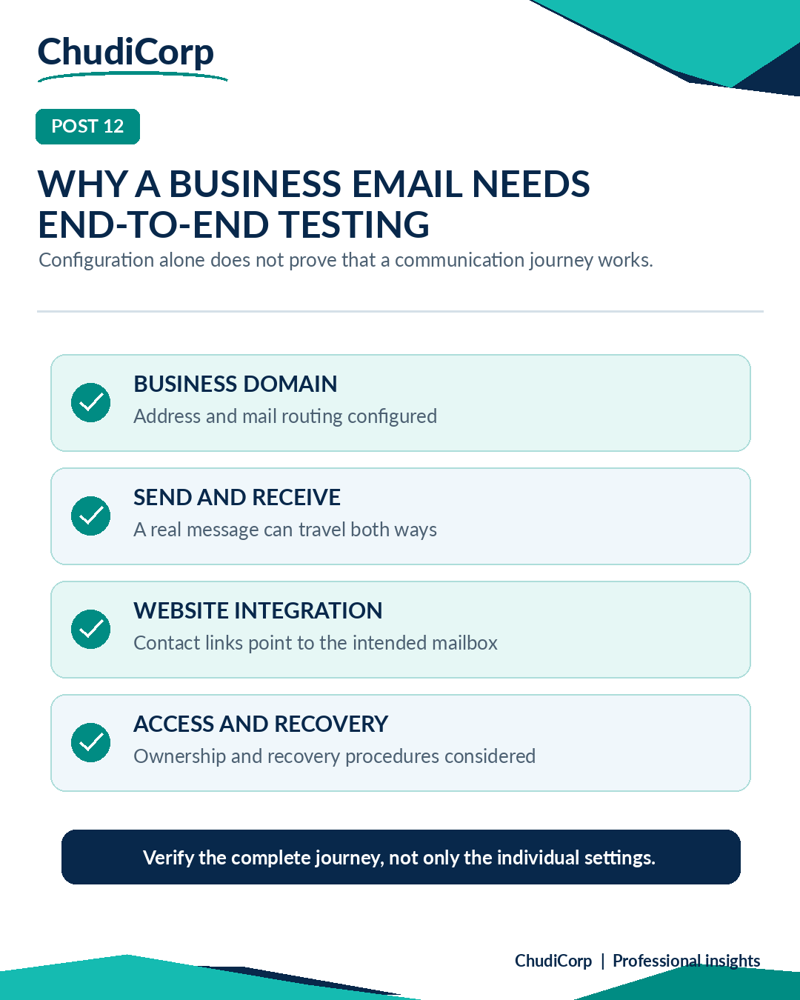

# Post 12: Why a Business Email Needs End-to-End Testing

**Workstream:** Systems Integration and Commercial Assurance  
**Scheduling status:** LinkedIn, scheduled for 24 November 2026 at 09:00 GMT by the project owner  
**Original LinkedIn URL:** Not added until independently confirmed  
**Evidence source:** Owner-verified and Lovable-reported  
**Evidence verification / timing:** Owner-observed historical checks; report-recorded link tests

## Original approved LinkedIn caption

A professional business email address looks like a small detail.

Until you start thinking about everything that needs to work behind it.

When setting up ChudiCorp, I wanted enquiries to come through a business-domain email address rather than relying entirely on a personal mailbox.

But configuring an address is only part of the job.

Can it receive a message?

Can it send a reply?

Do the website's contact links point to the correct address?

Can the right person access the mailbox?

What happens if account access needs to be recovered?

This reminded me of a basic principle in systems integration.

Configuration is not the same as end-to-end testing.

I like to think of an integration as a chain of activities, each with its own possible failure point.

If the chain breaks, the user experiences the whole service as broken, even if most individual components are working.

What's a seemingly simple integration that turned out to need more testing than expected?

#SystemsIntegration #BusinessAnalysis #DigitalTransformation

## Evidence-based professional case study

### Professional problem

When is an email setup actually working?

### ChudiCorp context

ChudiCorp moved its public contact to info@chudicorp.com and its administrator sign-in to a business-domain account.

### Professional technique

End-to-end integration testing across domain, sending, receiving and recovery.

### Implementation or delivery context

Site contact links updated (M17). Business-email admin sign-in with account setup and reset controls (M24).

### Testing and documentation

Contact link checks (Lovable-reported).

### Owner confirmation

Send and receive confirmed in Zoho; both admin sign-ins confirmed (Owner-verified).

### Supporting milestones

M17, M24.

### Illustrative or retrospective elements

Recovery is shown as "considered", not tested.

### Limitations and disclosures

Password-reset delivery and site-sent emails are unverified.

### Transferable professional lesson

Integration: test every step of the journey. Risk: plan account recovery.

## Evidence boundaries

The supporting internal development records remain private. Milestone references are traceability identifiers, not links to private reports. Lovable-reported tests are not represented as independent audits. Scheduled publication dates do not establish that a LinkedIn post was published.

[Back to content index](../CONTENT_INDEX.md) | [Portfolio overview](../README.md) | [Disclosures](../DISCLOSURE_AND_ATTRIBUTION.md)
