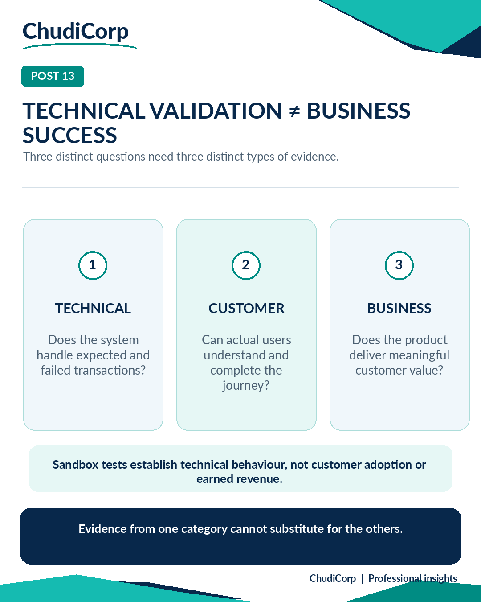

# Post 13: Technical Validation ≠ Business Success

**Workstream:** Systems Integration and Commercial Assurance  
**Scheduling status:** LinkedIn, scheduled for 26 November 2026 at 09:00 GMT by the project owner  
**Original LinkedIn URL:** Not added until independently confirmed  
**Evidence source:** Lovable-reported and owner-verified  
**Evidence verification / timing:** Historically performed in sandbox; report-recorded and owner-observed

## Original approved LinkedIn caption

A successful test payment is not the same as a successful business.

I've been examining how payment workflows should be validated before a digital product is ready to take real transactions.

One thing stands out.

We sometimes treat a successful test as proof that a product is ready.

But there are several different questions worth asking.

Technical validation: Does the system behave correctly when a payment succeeds, fails or is cancelled?

Customer validation: Can real users understand and complete the payment journey?

Business results: Is the product delivering genuine customer value and commercially meaningful outcomes?

Each requires different evidence.

A sandbox payment test can tell us something useful about technical behaviour.

It cannot establish customer satisfaction, commercial adoption or revenue.

For Business Analysts and Product Owners, I think the lesson is to define these success measures separately.

Otherwise, we risk celebrating a technically working feature before we understand whether it is delivering business value.

How do you distinguish technical acceptance from business success in your projects?

#BusinessAnalysis #ProductManagement #QualityAssurance

## Evidence-based professional case study

### Professional problem

What does a passing payment test prove?

### ChudiCorp context

ChudiCorp's checkout was tested only in Stripe Test Mode.

### Professional technique

Separating technical, operational and commercial evidence.

### Implementation or delivery context

Sandbox checkout with verified payment status (M06). Checkout recovery safeguards (M12).

### Testing and documentation

A protected sandbox payment confirmed (M07). Declined and authentication-failure cases left the request unpaid (M08). A post-recovery sandbox payment confirmed automatically (M13). (Lovable-reported plus Owner-verified.)

### Owner confirmation

The owner ran the card tests and checked the sandbox payment history.

### Supporting milestones

M06, M07, M08, M12, M13.

### Illustrative or retrospective elements

None.

### Limitations and disclosures

Test Mode only; this is not evidence of earned revenue or customer adoption.

### Transferable professional lesson

Commercial assurance: technical proof is not market proof. PM: define business success measures separately.

## Evidence boundaries

The supporting internal development records remain private. Milestone references are traceability identifiers, not links to private reports. Lovable-reported tests are not represented as independent audits. Scheduled publication dates do not establish that a LinkedIn post was published.

[Back to content index](../CONTENT_INDEX.md) | [Portfolio overview](../README.md) | [Disclosures](../DISCLOSURE_AND_ATTRIBUTION.md)
