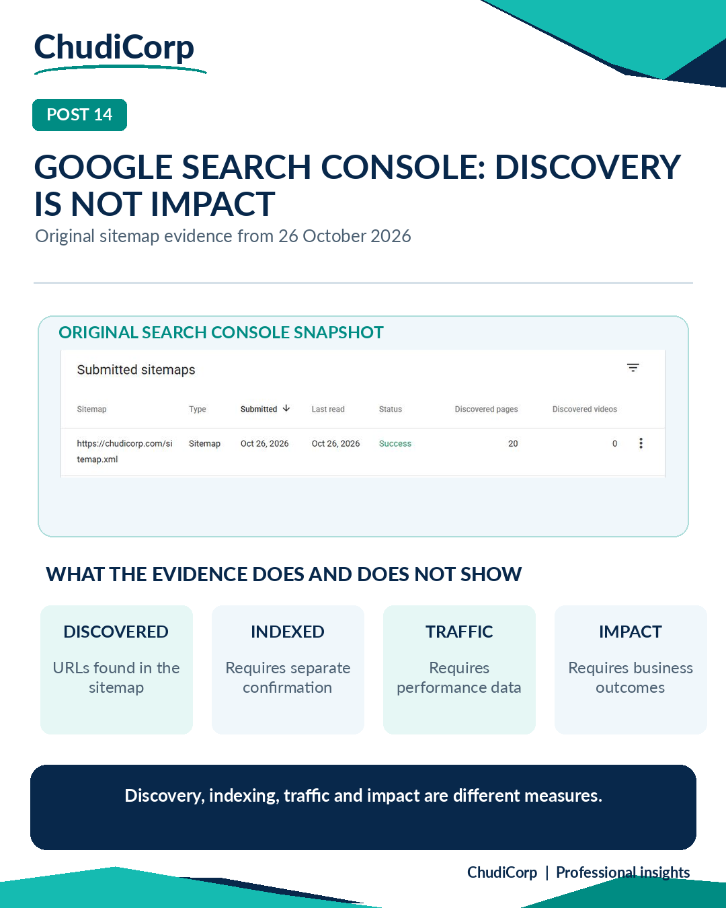

# Post 14: Google Search Console: Discovery Is Not Impact

**Workstream:** Data Analytics and Evidence  
**Scheduling status:** LinkedIn, scheduled for 28 November 2026 at 09:00 GMT by the project owner  
**Original LinkedIn URL:** Not added until independently confirmed  
**Evidence source:** Owner-verified documentary evidence  
**Evidence verification / timing:** Owner-supplied screenshots inspected during review; capture date unknown

## Original approved LinkedIn caption

Google discovered 20 URLs. Is that a success?

While working on ChudiCorp's website discoverability, a Google Search Console sitemap report showed a successful submission and 20 discovered URLs.

It was encouraging to see that progress.

But it also made me think about what the result actually means.

Did Google discover the pages? The sitemap report indicated that it had identified the URLs.

Were all the pages indexed? That wasn't established by the discovered-URL count.

Were people finding the website through search? That would require separate performance evidence.

Were those visitors finding something valuable? That is another question altogether.

This is where my interest in Business Analysis and Data Analytics comes in.

I think we sometimes confuse the successful completion of an activity with the achievement of a business outcome.

A useful performance framework should distinguish:

Activity → Output → Outcome → Impact.

Each stage answers a different question.

What is an example of a metric that looks like success but doesn't necessarily demonstrate business value?

#DataAnalytics #SEO #PerformanceMeasurement

## Evidence-based professional case study

### Professional problem

What does a successful sitemap submission actually tell you?

### ChudiCorp context

ChudiCorp published a sitemap and submitted it to Search Console.

### Professional technique

A measurement ladder: discovered, then indexed, then ranked, then visited, then impact.

### Implementation or delivery context

robots.txt, sitemap, canonical tags, structured data and exclusion of private pages from search (M20).

### Testing and documentation

The live files were checked at release (Lovable-reported).

### Owner confirmation

Screenshots supplied by the owner show Success and 20 discovered pages, with last-read dates of 26 October and 5 November 2026 (Owner-verified).

### Supporting milestones

M20.

### Illustrative or retrospective elements

The infographic is an educational presentation.

### Limitations and disclosures

Capture times are not independently established. Do not imply indexing, rankings, traffic or business results.

### Transferable professional lesson

Data: name the stage a metric measures. Marketing/Product: avoid vanity conclusions.

## Evidence boundaries

The supporting internal development records remain private. Milestone references are traceability identifiers, not links to private reports. Lovable-reported tests are not represented as independent audits. Scheduled publication dates do not establish that a LinkedIn post was published.

[Back to content index](../CONTENT_INDEX.md) | [Portfolio overview](../README.md) | [Disclosures](../DISCLOSURE_AND_ATTRIBUTION.md)
