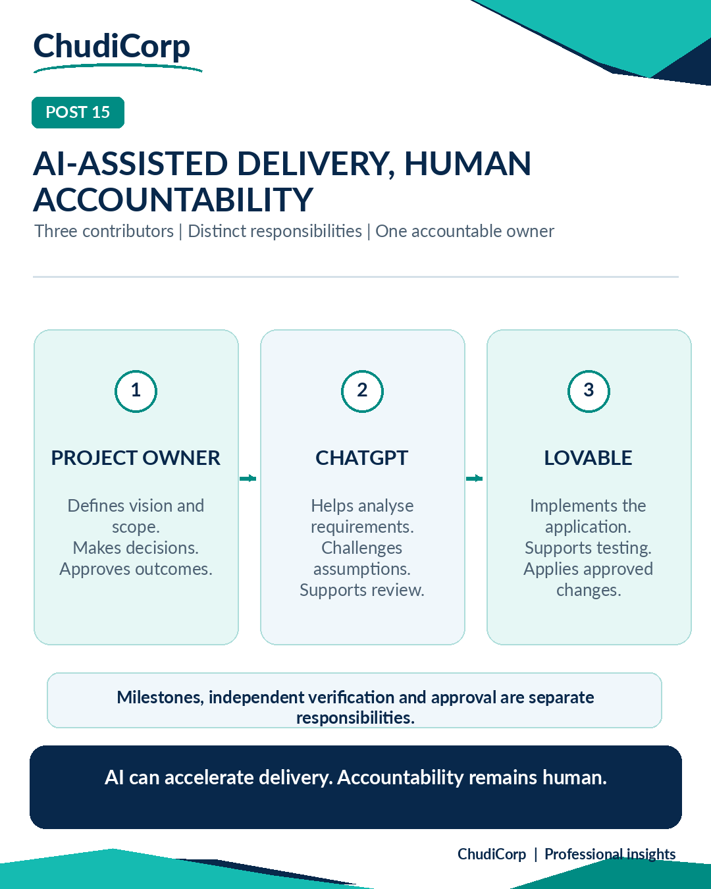

# Post 15: AI-Assisted Delivery, Human Accountability

**Workstream:** AI Governance and Information Protection  
**Scheduling status:** LinkedIn, scheduled for 30 November 2026 at 09:00 GMT by the project owner  
**Original LinkedIn URL:** Not added until independently confirmed  
**Evidence source:** Documented and owner-confirmed  
**Evidence verification / timing:** Owner-confirmed contributions; selected milestone examples report-recorded

## Original approved LinkedIn caption

AI helped me build ChudiCorp.

But it didn't remove my responsibility for the decisions.

Looking back at the project's development, I can see three distinct contributions.

I defined what I wanted to build, considered the business requirements and made decisions about what should or shouldn't proceed.

ChatGPT helped me examine requirements, structure development instructions, challenge assumptions and review results.

Lovable helped implement the website and supporting functionality.

Each contribution was valuable.

But the existence of a working feature didn't automatically make it acceptable.

There were still requirements to clarify, tests to interpret, limitations to document and decisions about what could safely go live.

One thing I found particularly useful was recording development milestones and keeping unfinished acceptance checks separate.

That made it easier to distinguish completed delivery work from operational readiness.

For me, that is an important lesson for Business Analysts, Project Managers, Product Owners and Programme Managers working with AI.

AI can accelerate delivery.

But accountability, governance and acceptance still need clear ownership.

As AI becomes more involved in delivery, what responsibilities should remain firmly with human decision-makers?

#AIGovernance #ProjectManagement #ProgrammeManagement

## Evidence-based professional case study

### Professional problem

Who is accountable when AI tools help deliver the work?

### ChudiCorp context

ChatGPT and Lovable both contributed; the owner made the decisions.

### Professional technique

Explicit role attribution with human approval gates.

### Implementation or delivery context

Recovery work only went ahead after the owner approved it (M09). Owner checklist sign-offs (M18). An owner-approved coordinated release (M23). Admin access granted by the owner (M24).

### Testing and documentation

Each example is documented in its own milestone. No single milestone proves the whole post.

### Owner confirmation

ChatGPT's role is owner-confirmed.

### Supporting milestones

M09, M18, M23, M24.

### Illustrative or retrospective elements

The role diagram is a summary.

### Limitations and disclosures

ChatGPT's contributions are owner-confirmed only. Not every activity had a formal gate.

### Transferable professional lesson

AI governance: tools assist, people approve. PM: keep a record of decisions.

## Evidence boundaries

The supporting internal development records remain private. Milestone references are traceability identifiers, not links to private reports. Lovable-reported tests are not represented as independent audits. Scheduled publication dates do not establish that a LinkedIn post was published.

[Back to content index](../CONTENT_INDEX.md) | [Portfolio overview](../README.md) | [Disclosures](../DISCLOSURE_AND_ATTRIBUTION.md)
